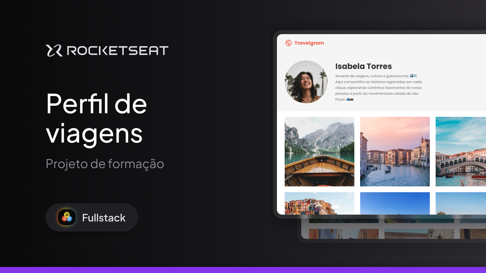

# Perfil de Viagens - Travelgram

Perfil de viagens desenvolvido como desafio prático de HTML e CSS da formação Full Stack da Rocketseat.

O projeto tem como proposta criar uma página de perfil de viagens utilizando HTML semântico e CSS, com foco na organização dos elementos por meio do Flexbox.

## Preview



## Tecnologias

- HTML5
- CSS3
- Flexbox

## Funcionalidades

- Estrutura inicial de uma página de perfil de viagens.
- Organização dos estilos em arquivos separados.
- Reset global para padronizar o comportamento dos elementos.
- Layout preparado para construção com Flexbox.

## Como executar

1. Clone ou baixe este repositório.
2. Abra o arquivo `index.html` no navegador.

Para acompanhar as alterações durante o desenvolvimento, também é possível utilizar a extensão **Live Server** no VS Code.

## Estrutura do projeto

```text
.
├── index.html          # Estrutura da página
├── readme.md           # Documentação do projeto
├── styles/
│   ├── global.css      # Reset e estilos globais
│   └── index.css       # Estilos específicos da página
├── .github/
│   └── cover.png       # Imagem de preview do projeto
└── .gitignore          # Arquivos ignorados pelo Git
```

## Aprendizados

Este desafio pratica conceitos fundamentais de desenvolvimento web, incluindo:

- Estrutura semântica com HTML.
- Separação entre estilos globais e estilos específicos.
- Uso de seletores e propriedades CSS.
- Organização de layouts com Flexbox.
- Padronização de margens, preenchimentos e dimensionamento com `box-sizing`.

## Próximos passos

- Construir o cabeçalho e o perfil do viajante.
- Adicionar informações sobre o perfil e os destinos visitados.
- Inserir as imagens da galeria de viagens.
- Finalizar o layout responsivo para diferentes tamanhos de tela.

## Sobre mim

Engenheiro de Software e desenvolvedor apaixonado por tecnologia, com foco em desenvolvimento Full Stack. Atualmente, estudo e trabalho principalmente com JavaScript, TypeScript, Angular, React e Node.js.

## Contato

[](https://www.linkedin.com/in/jose-martinez-352032222/)
[](mailto:juniorjose1925@gmail.com)
[](https://my-portfolio-jose-martinez.netlify.app/)
