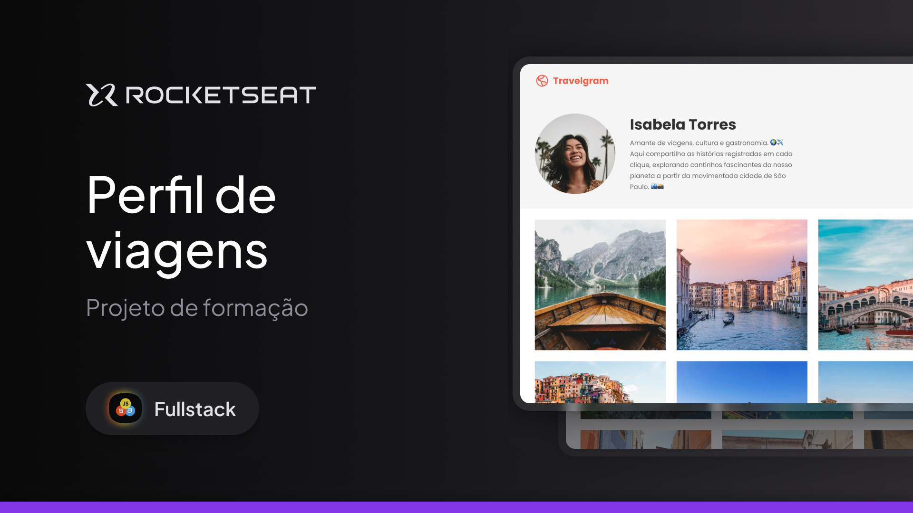

# Perfil de Viagens - Travelgram

Perfil de viagens desenvolvido como desafio prático de HTML e CSS da formação Full Stack da Rocketseat.

O projeto apresenta o perfil da viajante Isabela Torres, com navegação, informações pessoais, galeria de fotos e rodapé. A interface utiliza HTML semântico, CSS organizado por responsabilidade e layouts construídos com Flexbox.

## Preview



## Tecnologias

- HTML5
- CSS3
- Flexbox
- JavaScript

## Funcionalidades

- Navegação com logotipo, busca, links e foto de perfil.
- Seção de perfil com descrição, localização, países visitados e quantidade de fotos.
- Galeria com 12 imagens de viagens.
- Layout responsivo construído com Flexbox.
- Galeria adaptável para diferentes larguras de tela:
  - 4 imagens por linha em telas grandes;
  - 3 imagens por linha em tablets;
  - 2 imagens por linha em celulares;
  - 1 imagem por linha em telas muito pequenas.
- Rodapé empilhado verticalmente em telas de até `600px`.
- Atualização automática do ano no rodapé usando JavaScript.
- Organização dos estilos em arquivos separados.
- Reset global para padronizar o comportamento dos elementos.

## Como executar

1. Clone ou baixe este repositório.
2. Abra o arquivo `index.html` no navegador.

Para acompanhar as alterações durante o desenvolvimento, também é possível utilizar a extensão **Live Server** no VS Code.

## Estrutura do projeto

```text
.
├── index.html              # Estrutura semântica da página
├── readme.md               # Documentação do projeto
├── js/
│   └── script.js           # Atualização automática do ano
├── assets/
│   ├── Logo.svg            # Logotipo
│   ├── profile_pic.png     # Foto do perfil
│   ├── icons/              # Ícones de navegação e informações
│   └── images/             # Imagens da galeria
├── styles/
│   ├── global.css          # Reset, variáveis e estilos globais
│   ├── index.css           # Importação dos estilos
│   ├── nav.css             # Navegação
│   ├── header.css          # Perfil e informações
│   ├── main.css            # Galeria responsiva
│   └── footer.css          # Rodapé e comportamento mobile
├── .github/
│   └── cover.png           # Imagem de preview do projeto
└── .gitignore              # Arquivos ignorados pelo Git
```

## Aprendizados

Este desafio pratica conceitos fundamentais de desenvolvimento web, incluindo:

- Estrutura semântica com HTML.
- Separação entre estilos globais e estilos específicos.
- Uso de seletores e propriedades CSS.
- Organização de layouts com Flexbox.
- Criação de layouts responsivos com `flex-wrap`, `flex-basis` e media queries.
- Uso de `aspect-ratio` para manter as imagens quadradas.
- Padronização de margens, preenchimentos e dimensionamento com `box-sizing`.

## Sobre mim

Engenheiro de Software e desenvolvedor apaixonado por tecnologia, com foco em desenvolvimento Full Stack. Atualmente, estudo e trabalho principalmente com JavaScript, TypeScript, Angular, React e Node.js.

## Contato

[](https://www.linkedin.com/in/jose-martinez-352032222/)
[](mailto:juniorjose1925@gmail.com)
[](https://my-portfolio-jose-martinez.netlify.app/)
